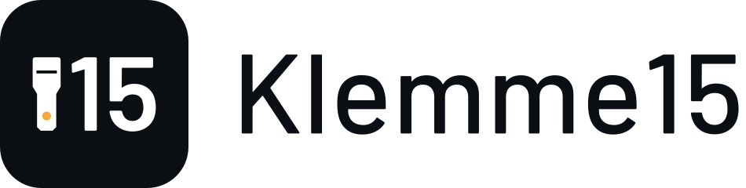

<h1 align="center">
  <picture>
    <source media="(prefers-color-scheme: dark)" srcset="docs/brand/klemme15-lockup-dark.svg">
    
  </picture>
</h1>

*Named after terminal 15 (Klemme 15), the ignition-on line every BMW diagnosis starts with.*

**Open-source BMW diagnostics for everyone.** Scan every module, read and clear faults, watch live engine data and export shareable reports. Use a cheap K+DCAN cable on Windows, macOS or Linux.

> **Status: early alpha.** Confirmed on a real 2006 E90 325i over D-CAN: 12 modules identified with part numbers, faults read and cleared, live data recorded, fuel trim test run. The other families and the service functions are built from BMW's data and tested against demo cars. Please test on your car and [report what you see](CONTRIBUTING.md#report-a-test-drive).

Klemme15 is an independent project. It is not affiliated with or endorsed by BMW AG. BMW, ISTA, INPA and EDIABAS are trademarks of BMW AG.

---

## Why Klemme15

| | Dealer-style tools | Klemme15 |
|---|---|---|
| Cost | Licensed or grey-market | Free, GPLv3 |
| Platforms | Windows only, heavy install | Windows, macOS, Linux; one small app |
| Quick test speed | Slow, many steps | Built for speed: modules that aren't fitted are skipped after a short timeout (under 1 s for a full E90 scan in the simulator; real-car timing still to be measured) |
| Without BMW files | — | Works out of the box with Klemme15's own protocol stack |
| With your BMW files | Yes | Optional **EDIABAS mode** runs your own SGBDs for full coverage (Windows) |
| Reports | Printouts | HTML / Markdown / JSON you can post on a forum |
| Transparency | Closed | Every byte on the wire visible in the traffic log |
| No car handy | — | Built-in **demo car** (E46 and E90) |

## Features

- **Garage**: pick your exact model (E46 323i through E90 335i). Every model has its own **demo car** with the modules it actually has and the faults it's known for, so you can try everything without a cable.
- **See where faults are**: a top-view drawing of the car. Each module lights up where it physically sits as the quick test reaches it, and every fault is pinned to the part it points at: a misfire on cylinder 3, lean codes at the intake, a thermostat at the front of the engine, a fuel pump fault at the tank.
- **Quick test**: checks battery voltage, finds every fitted module with one broadcast, identifies each and reads its fault memory. Covers all 44 known E90-family modules and 23 E46 modules, including options like xDrive, TPMS, alarm, memory seats and the convertible top.
- **ISTA-grade texts with your own files** (Windows): Klemme15 finds your EDIABAS, INPA or ISTA SGBD files automatically and reads faults the way ISTA does on these cars: official fault text for your exact module version, mileage, frequency, environment conditions, and the info memory.
- **Official BMW meaning for every code, on any OS**: one click in the Garage downloads the free community fault database [bmw-unified-db](https://github.com/gediz/bmw-unified-db) (13 MB, checksum-verified), or Klemme15 reads the `.prg` files from your own ISTA/INPA install. Klemme15 works out which version of each module your car has (the same code means different things on different versions), shows BMW's English where BMW wrote one, and puts the rest into English with its own glossary, with a Translate button for BMW's original German. See [where meanings come from](docs/FAULT-DATA.md).
- **Researched meanings without BMW files**: 202 BMW fault codes (106 high confidence) researched from owner forums, shop guides and BMW service bulletins, written in our own words, each with its sources and engine scope; plus all 2,066 standard OBD-II codes.
- **Faults**: BMW and OBD-II codes, active vs stored vs info memory, plain-English descriptions, practical tips, a "check here" location, and where each meaning comes from (official SGBD text, or community meaning with confidence and clickable sources). Clear per module or all at once.
- **Readings**: every status value each module reports, like INPA's module screens: oxygen sensor voltages and fuel trims per bank, VANOS positions, injectors, knock, throttle and pedal, every wheel speed, steering angle, battery sensor, temperatures, switch states and learned values. Grouped by system, labelled in English, searchable, with auto-refresh and one-click pinning to Live data. Values are computed by BMW's own scripts from your ISTA/INPA/EDIABAS files (Windows, macOS and Linux), and nothing is changed on the car. Try it on any demo car.
- **Troubleshooting guides**: for common problems (mixture, misfires, VANOS/Valvetronic, cooling, fuel pressure, boost, charging, bus faults, wheel speed sensors, steering angle, steering lock, oxygen sensor heaters, secondary air, airbags), a **Troubleshoot** button under the fault gives step-by-step checks, with shortcuts to the readings that confirm each step. Written by contributors in plain words; add your own in `src/Klemme15.Data/db/guides.json`.
- **Service functions** (experimental): 75 workshop functions. **Service reminder reset** (oil, brake pads, brake fluid, microfilter, spark plugs, vehicle check; E46 oil and inspection), **battery registration**, **engine adaptation reset**, **Valvetronic and DISA learning**, **cylinder cut-out test** to find a misfire, fuel tank leak test, secondary air and catalyst checks, VANOS flush; **component tests** (radiator fan, fuel pump, thermostat, water pump, secondary air pump, throttle, DISA, purge valve); **diesel**: particulate filter service, glow plug reset, EGR/swirl flap learning, injector code programming, cylinder balance, cooling system bleed; **DSC**: steering angle and sensor calibration, ABS unit bleeding, flat tyre monitor reset, wheel speed sensor test; **gearbox**: automatic adaptation reset, SMG clutch and gear learning and bleeding, xDrive transfer case relearn; **body**: windows, sunroof, climate flaps, rain sensor, parking sensors, gauge test; **steering lock** (early E90 with a key slot): read why the lock complained and clear its counters, without touching keys or immobiliser codes; **retrofits**: check both flaps after fitting the three-stage intake manifold to an N52. Each one checks the car first, asks you to confirm each requirement, runs BMW's own procedure for your module version and shows the result; tests always switch the part off again. See the [full list](docs/SERVICE-FUNCTIONS.md) and [how they are kept safe](docs/SERVICE.md).
- **Guided tests with a verdict** (Tests page): a **fuel trim test** (idle, then 2,500 rpm: vacuum leak or fuel delivery?), a **VANOS test** (target vs actual camshaft angle while you blip the throttle), a **cylinder roughness chart** to spot a weak cylinder before it sets a misfire, **"Why won't it start?"**, a read-only triage that reads battery voltage, whether the engine cranked and the start-chain faults (engine, key, steering lock) and routes them to a cause — battery, starter, steering lock, sensor, fuel, ignition, or a genuine immobiliser fault for a shop — and a **cooling system bleed assistant** for engines with an electric water pump (N51-N55): it walks you through BMW's own 12-minute bleed routine and watches the pump run. With or without BMW files.
- **Coding** (experimental): **back up** the coding of any comfort module (footwell module, cluster, junction box, climate, roof module...) with no BMW data at all, **compare** it later to see exactly what any coding tool changed, and **restore** it in one click with every block read back. With your own NCS Expert data folder, see every setting **by name**, and switch popular options: **LED bulb-check off** (indicators, brake, plate, parking and fog lights), **digital speed** and **instant consumption** in the cluster, **dial lighting always on**, **mirror fold** on locking, windows that keep closing when a door opens, wipers that finish their sweep. Writing unlocks only after Klemme15 decodes the module exactly as NCS Expert does; it saves a backup first, changes only those settings' bits, reads everything back and puts the original back automatically if anything is off. The key module (CAS), engine, gearbox, brakes and airbag modules are never coded. After verifying, you can **export** your module's map to contribute it, and once a map is shipped, an owner with the same module can use its toggles with no NCS data — still with backup, read-back and auto-restore. See [docs/CODING.md](docs/CODING.md).
- **How-to guides** (Tests page): where every module sits on an E90, fuses, battery and the B+ cable, a parasitic battery drain test, engine and body connector notes, the trunk lid harness, and the FRM3 problem, all in our own words with sources. Fault-specific guides also appear under the faults they explain.
- **Faults sorted by what matters**: fix now, worth checking, and background (info and shadow memory, one-off events after battery work), so ten codes don't turn into ten parts.
- **Restart a frozen module** (iDrive screen, Bluetooth, amplifier, climate, parking sensors and more) with BMW's own reset, instead of disconnecting the battery. Never offered for the engine, brakes, airbag, steering, gearbox or key modules.
- **FRM3 protection**: Klemme15 tells the footwell module generations apart from the part number (FRM1, FRM2, or the FRM3 that can corrupt itself when the voltage dips during a write) and shows it on the Vehicle page. A fragile FRM is only coded or put through a service function at 13.0 V or more (a charger), and its faults are only cleared at 12.5 V or more; an FRM it can't identify gets the same rules. Every other write needs a solid 12.5 V.
- **Copy for a forum post**: a short summary of the car, its modules and what needs fixing, with the VIN removed, ready for E90Post, Reddit or Bimmerforums (`klemme15 scan --forum`).
- **Wi-Fi and network cables**: a K+DCAN cable behind ser2net, an ESP32 bridge or any adapter that shares the serial port on the network (`rfc2217://192.168.4.1:2217` or `tcp://host:port`). Best on D-CAN cars.
- **Headless mode with a phone dashboard**: `klemme15 serve` on a Raspberry Pi (or laptop) left on the OBD port serves a **phone dashboard** (gauges, live tiles with sparklines, warnings for overheating, charging and fuel trims, and the engine's faults sorted by priority) to any phone on the same Wi-Fi, plus JSON over HTTP and MQTT for Grafana or Home Assistant. See [docs/HEADLESS.md](docs/HEADLESS.md).
- **Live data**: RPM, temperatures, fuel trims, load, MAF, boost, voltage and more, with sparklines, min/max and CSV recording.
- **Analyse** (datalogging): load a CSV you recorded here or anywhere, scatter any channel against another (fuel trims against RPM or load), see a value averaged over a tuning-style map (RPM across, load up), and play the whole log back with a scrubber while every channel reads out in step. Record on the Live page and press **Analyse** to jump straight in.
- **Expert mode** (EDIABAS): Tool32-style job runner; pin any numeric result to the live data page.
- **Reports**: one click to save a scan as HTML, Markdown or JSON.
- **Traffic log**: every byte sent and received, savable for bug reports.
- Dark and light themes. Command line for scripting and headless use.

| Vehicle | Faults |
|---|---|
|  |  |
|  |  |

Screenshots are rendered automatically by CI from the demo cars on every push, so they always show the current build.

## Supported cars

| Family | Cable switch | Native mode | EDIABAS mode |
|---|---|---|---|
| E46 3 Series (1999-2006) | K-line | Module ident (DS2), engine OBD-II faults and live data | Full fault memory of every module |
| E90/E91/E92/E93 3 Series (2006-2013) | D-CAN | Ident and fault memory of every module (KWP2000), engine readings, OBD-II live data | Full, with BMW fault texts |
| E81/E82/E87/E88 1 Series (2007 on), E60/E61 5 Series and E63/E64 6 Series (2007 on), E70 X5 / E71 X6, E89 Z4 | D-CAN | Like the E90 family | Full |
| E39 5 Series, E53 X5, E38 7 Series | K-line | Like the E46 | Full |

The E90 family is confirmed on a real car (a 2006 325i); the others are built from BMW's module data and tested against demo cars, so please [report a test drive](CONTRIBUTING.md#report-a-test-drive). E60 and E87-family cars built before March 2007 have no D-CAN and need EDIABAS mode. F- and G-series (Ethernet cable) are on the [roadmap](docs/ROADMAP.md).

## Quick start

1. Install the cable's FTDI driver (Windows usually does this automatically).
2. Plug the cable into the OBD port under the dashboard and set its switch: **K-line** for E46 and older, **D-CAN** for E90 and newer.
3. Ignition on (key position 2, engine off) for scans; engine running for live data.
4. Start Klemme15, choose your car and port, press **Connect**, then **Run quick test**.

No car nearby? Pick any model in the garage and press **Open demo car**.

### Command line

```bash
klemme15 ports                                   # find the cable
klemme15 scan --vehicle E9x --port COM3 --report scan.html
klemme15 live --vehicle E46 --port /dev/ttyUSB0 --pids rpm,coolant,stft1,ltft1 --csv drive.csv
klemme15 faults --module DME --port COM3
klemme15 readings --module DME --port COM3 --ediabas "C:\ISTA\Ediabas\Ecu" --filter lambda
klemme15 clear --module DME --port COM3
klemme15 service                                 # list service functions
klemme15 service battery-registration --port COM3 --experimental
klemme15 service service-reset --item oil --port COM3 --ediabas "C:\ISTA\Ediabas\Ecu" --experimental
klemme15 scan --demo --vehicle E9x --model 335i # try it without a car
klemme15 scan --port COM3 --forum                # summary for a forum post, VIN removed
klemme15 test fuel-trims --port COM3             # guided test with a verdict
klemme15 serve --port rfc2217://192.168.4.1:2217 --mqtt 192.168.1.10   # headless, over Wi-Fi
```

Official BMW meanings for every code (optional, see [docs/FAULT-DATA.md](docs/FAULT-DATA.md)):

```bash
klemme15 db download                             # fetch bmw-unified-db from its GitHub release (13 MB)
klemme15 code E9x.DSC 5E1A --model 325i          # what does a code mean on a given model?
klemme15 scan --port COM3 --ecu "C:\ISTA\Ediabas\Ecu"   # or read texts from your own ISTA/INPA files
```

On Windows with EDIABAS mode: add `--ediabas C:\EDIABAS\Ecu`, and run any job with `klemme15 job D_0012 IDENT --ediabas C:\EDIABAS\Ecu --port COM3`.

## Building from source

Requires the [.NET 10 SDK](https://dotnet.microsoft.com/download).

```bash
git clone https://github.com/Expos-AI/Klemme15.git
cd Klemme15
dotnet test tests/Klemme15.Tests              # protocol + simulator tests
dotnet run --project src/Klemme15.App          # desktop app
dotnet run --project src/Klemme15.Cli -- scan --demo
```

For EDIABAS mode on Windows, run `scripts\get-ediabaslib.ps1` once (it downloads EdiabasLib into `external/ediabaslib`); the next build includes EDIABAS mode automatically. On macOS and Linux (or Windows without EdiabasLib) build `Klemme15.CrossPlatform.slnf` rather than `Klemme15.sln`, because the full solution includes the Windows-only EDIABAS project.

## How it works

```
 App (Avalonia)   CLI
        \         /
     Core: scanner, reports, models  <-- Data: open JSON database (modules, codes)
        |
  IDiagnosticBackend
     /            \
 Native backend       EDIABAS backend (Windows)
 DS2 / KWP2000 /      EdiabasLib running YOUR
 OBD-II, clean-room   own SGBD files
     |
 ITransport: K+DCAN serial port  |  virtual car (demo + tests)
```

Details in [docs/ARCHITECTURE.md](docs/ARCHITECTURE.md).

## Legal and data policy

- Klemme15 **contains no BMW software, SGBD files, fault texts, documents or wiring diagrams**, and contributions must not add any.
- The native protocol stack is written from public standards (ISO 14230, ISO 9141-2, SAE J1979) and community knowledge.
- EDIABAS mode runs files **you already have** from your own installation. They are never bundled or uploaded.
- Fault descriptions in the database are written by contributors in their own words, with sources. See `tools/research` for how they're researched and merged.
- BMW's own fault texts are only ever **read from data the user chooses to provide**: their own ISTA/INPA/EDIABAS files, or the third-party [bmw-unified-db](https://github.com/gediz/bmw-unified-db) download, which that project publishes and licenses itself (it states the texts are BMW-derived). Klemme15 links to it and never copies it into this repository. Details: [docs/FAULT-DATA.md](docs/FAULT-DATA.md).
- Klemme15 never unlocks or reads BMW's protected ISTA databases. The standard OBD-II titles come from python-OBD (GPL-2.0-or-later).

## Safety

Diagnostics are read-only by default. Clearing faults asks first. Service functions check the car, ask you to confirm each requirement and only run when you press Run; unverified ones need the experimental switch. Coding is limited to comfort modules, always backed up first and verified against NCS Expert's reading of your module before anything is written (see [docs/CODING.md](docs/CODING.md)). Flashing, keys, the key module (CAS) and anything touching the immobiliser are **not** included. Never use Klemme15 while driving; have a passenger watch live data or record it to CSV.

## Privacy

Everything Klemme15 reads from your car stays on your computer. It has no account, no telemetry and no server; it only goes online when you ask it to (downloading the optional fault database, opening a link, or a network cable/`serve` you configure). Your VIN is never transmitted. See [PRIVACY.md](PRIVACY.md).

## Contributing

The fastest way to help is to **test on your car** and send the saved report and traffic log. See [CONTRIBUTING.md](CONTRIBUTING.md) and [docs/CONTRIBUTING-DATA.md](docs/CONTRIBUTING-DATA.md).

## Credits

- [EdiabasLib](https://github.com/uholeschak/ediabaslib) by Ulrich Holeschak (GPLv3), used for EDIABAS mode.
- [bmw-unified-db](https://github.com/gediz/bmw-unified-db) for the optional BMW fault dictionaries (downloaded by the user, not bundled).
- [Avalonia UI](https://avaloniaui.net) for the cross-platform interface.
- [python-OBD](https://github.com/brendan-w/python-OBD) for the standard OBD-II code titles.
- [Barlow](https://github.com/jpt/barlow) typeface by Jeremy Tribby (SIL Open Font License 1.1, see `src/Klemme15.App/Assets/Fonts/OFL.txt`).

## License

GPL-3.0-or-later. See [LICENSE](LICENSE).
