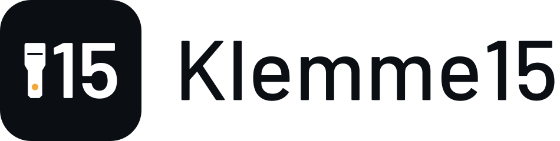
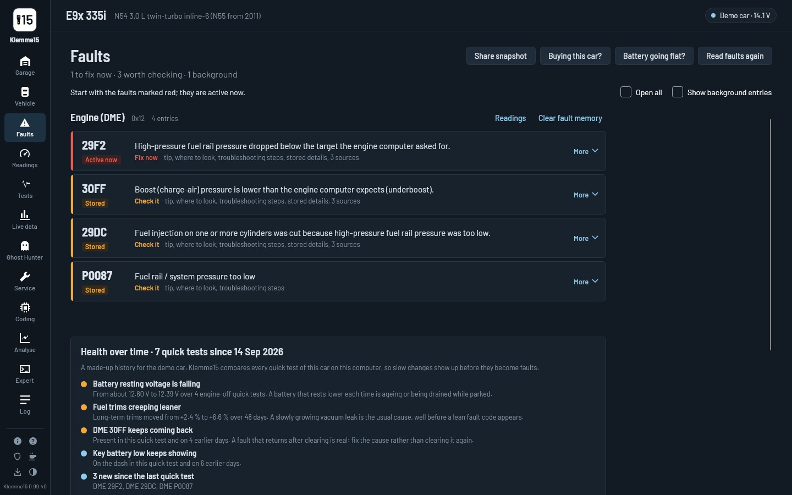
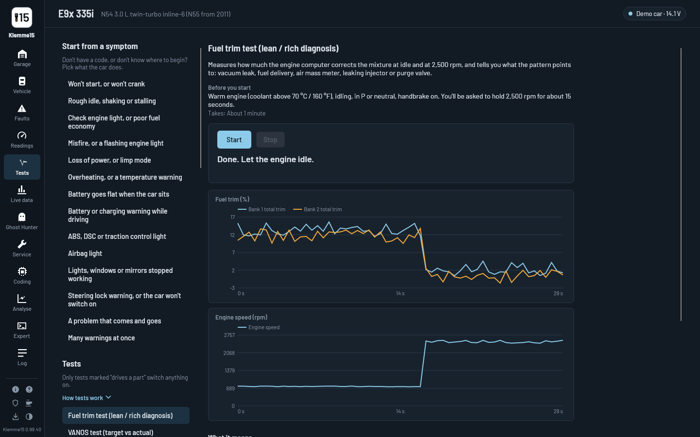
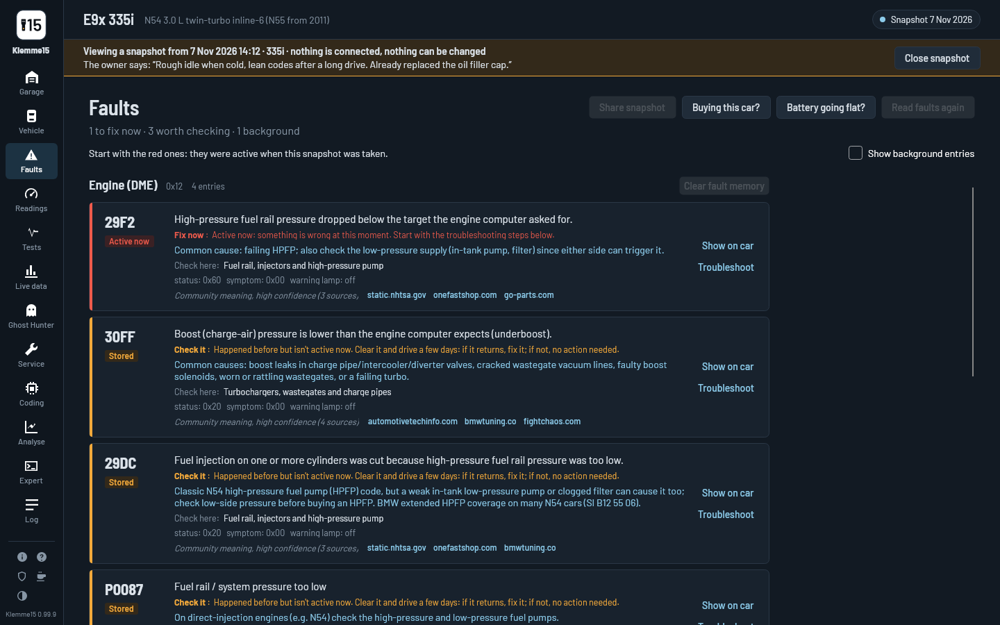
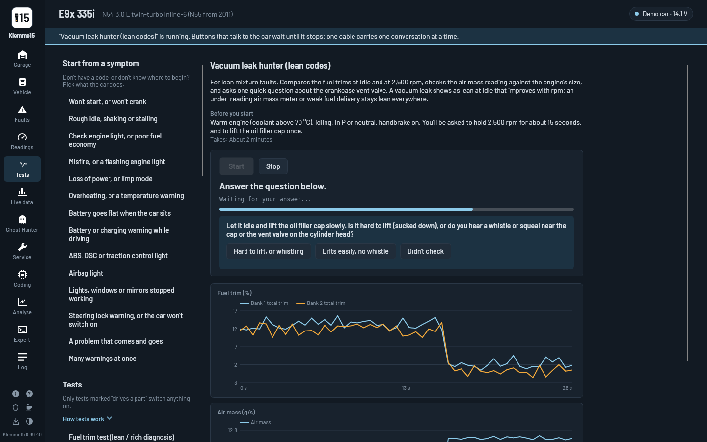

<h1 align="center">
  <picture>
    <source media="(prefers-color-scheme: dark)" srcset="docs/brand/klemme15-lockup-dark.svg">
    
  </picture>
</h1>

*Named after terminal 15 (Klemme 15), the ignition-on line every BMW diagnosis starts with.*

**Free, open-source, offline diagnostics for older BMWs.** Scan every module, find out what each fault and dash warning really means, watch your car's health over time, test parts before you buy them, run workshop service functions and back up or code comfort modules. One cheap K+DCAN cable, on Windows, macOS or Linux. No account, no subscription, no cloud.

> **Status: early alpha, tested on a real car.** Confirmed on a 2006 E90 325i over D-CAN: every module identified with part numbers, faults and Shadow / Info memory read and cleared, dash message history decoded, live data recorded, fuel trim test run, and battery registration done on the engine computer. Everything else is built from BMW's data and tested against demo cars; features that change something on the car are marked experimental until someone confirms them. Please test on your car and [report what you see](CONTRIBUTING.md#report-a-test-drive).

Klemme15 is an independent project. It is not affiliated with or endorsed by BMW AG. BMW, ISTA, INPA, NCS Expert and EDIABAS are trademarks of BMW AG.

| Faults, health and the car's story | Component tests with live graphs |
|---|---|
|  |  |
| **A shared snapshot, opened read-only** | **A diagnostic chain asking its question** |
|  |  |

Screenshots are rendered by CI from the demo cars on every push, so they always show the current build. [All of them](https://github.com/Expos-AI/Klemme15/tree/screenshots).

---

## Install

**Windows (recommended, no security warning):**

```powershell
winget install Expos-AI.Klemme15
```
or with [Scoop](https://scoop.sh):
```powershell
scoop bucket add klemme15 https://github.com/Expos-AI/Klemme15
scoop install klemme15
```

**Any platform (direct download):** grab the `.zip` for your system from the [latest release](https://github.com/Expos-AI/Klemme15/releases/latest), unzip it anywhere and run `Klemme15`. It's portable: there's no installer.

> Windows may show a SmartScreen prompt on a directly downloaded `.zip` because the build isn't code-signed yet (on the [roadmap](docs/ROADMAP.md)). winget and Scoop avoid it. Otherwise click **More info → Run anyway**, or first check the download's SHA-256 against the release notes.

## What it does

### Find out what's wrong
- **Quick test**: checks the battery, finds every fitted module with one broadcast, identifies each one (part number, coding index) and reads its fault memory. Knows 45 E90-family modules and 23 E46 modules, options included.
- **Faults sorted by what matters**: fix now, worth checking, and background (Shadow / Info memory, leftovers of battery work), so ten codes don't turn into ten parts. Clear one module or all of them, Shadow / Info memory included, as ISTA does.
- **Every code explained**: 203 BMW codes researched in our own words with sources and confidence, all 2,066 standard OBD-II codes, and a meaning from its number range and module for any code no source describes. Optionally, BMW's own meaning for your exact module version, from the free [bmw-unified-db](https://github.com/gediz/bmw-unified-db) download or your own ISTA/INPA files ([how](docs/FAULT-DATA.md)).
- **Dash messages (Check Control)**: why the triangle is lit even with no fault code. 396 messages decoded in our own words, with severity and what to do ([details](docs/CHECK-CONTROL.md)).
- **Your car's story**: the instrument cluster remembers its last few dozen dash warnings with the mileage. Klemme15 tells them as a timeline and spots the patterns: five systems complaining at once is a voltage dip, not five faults.
- **See where it is**: a top view of the car with each module where it sits and each fault pinned to the part it points at.

### Get help from anyone, anywhere
- **Snapshots (.k15)**: save your whole car in one file (modules, faults, dash messages, the car's story, health trends, the last minute of live data, test graphs) and attach it to a forum post. Whoever opens it explores your car read-only, as if they were plugged in, with your note on top. The VIN is removed everywhere ([how it works](docs/SNAPSHOTS.md)).
- **Buying a used BMW?** The pre-purchase check compares the mileage the modules recorded with the odometer, flags safety faults and freshly cleared memories, and saves a buyer's report.

### Keep an eye on it over time
- **Health over time**: each quick test of a real car saves a small snapshot on your computer (no VIN, never uploaded). Klemme15 flags what's drifting before it becomes a fault: a battery resting lower each week, charging out of range, fuel trims creeping lean, faults that keep coming back, parts that test worse than last time.
- **Your cars**: the Garage lists every car you've scanned, with its latest state and most important trend. A fleet view for a household or a small shop.

### Test before you buy parts
- **Guided tests with live graphs**: fuel trims at idle and 2,500 rpm (vacuum leak or fuel delivery?), VANOS target against actual, cylinder roughness, "why won't it start?", the electric water pump's requested against actual speed, and a 12-minute cooling bleed assistant. Each ends with a plain verdict.
- **Diagnostic chains**: a mechanic's reasoning, written by the community and run step by step: the Vacuum leak hunter compares trims at idle and 2,500 rpm, checks airflow against engine size and asks about the crankcase vent valve; the Charging system check tells a tired battery from a weak alternator. Offered under matching faults; anyone can write one ([how](docs/CHAINS.md)).
- **How to check it**: multimeter and swap checks under matching faults (connectors, grounds, VANOS solenoids, coils, pump power, oxygen sensor heaters, wheel speed sensors, the sensors behind the mirror), plus troubleshooting guides and how-to guides with where things are. In our own words with sources.
- **Readings and live data**: every value each module reports (sensor voltages, fuel trims per bank, VANOS, injectors, knock, wheel speeds, steering angle, learned values), live data with CSV recording, and an **Analyse** page to scatter and replay a log.

### Do the workshop jobs yourself
- **Service functions** (experimental): 75 functions, including service reminder reset, battery registration (confirmed on a real E90), adaptation resets, Valvetronic and DISA learning, cylinder cut-out, component tests, diesel, DSC, gearbox and body functions. Each checks the car first and asks you to confirm every requirement ([full list](docs/SERVICE-FUNCTIONS.md), [how they're kept safe](docs/SERVICE.md)).
- **Restart a frozen module** (iDrive, Bluetooth, amplifier, climate...) with BMW's own reset instead of disconnecting the battery.

### Code comfort options, safely
- **Back up, compare and restore** any comfort module's coding with no BMW data at all.
- **Quick codes** (experimental): LED conversion (every bulb warning off in one write), digital speed, mirror fold, windows closing on lock and more. An option only unlocks when Klemme15 knows exactly where it lives on your exact module: verified against your NCS Expert reading, learned by watching another coding tool, or a shared **coding map** from the library. Every write is backed up, read back and put back automatically if anything is off ([walkthrough](docs/QUICK-CODES.md), [details](docs/CODING.md)).
- **Retrofit checker**: notices replaced and added modules from their part numbers, explains what common jobs need (LCI tail lights, LED bulbs, a used FRM or cluster, a different battery, parking sensors), and checks the car afterwards. It never writes the vehicle order, flashes or touches mileage.
- **FRM3 protection**: the footwell module that can corrupt itself on a voltage dip is recognised from its part number and only written to at 13.0 V or more.
- The key module (CAS), engine, gearbox, brakes and airbag modules are **never coded**.

### Share and automate
- **Reports** in HTML, Markdown or JSON, and **Copy for a forum post** with the VIN removed.
- **Traffic log** of every byte, for bug reports.
- **Command line**, **network cables** (ser2net, ESP32 bridges), and **headless mode** with a phone dashboard and MQTT for Grafana or Home Assistant ([docs](docs/HEADLESS.md)).
- **Expert mode** (EDIABAS): a Tool32-style job runner.
- Built-in **demo cars** for every model, dark and light themes.

## Supported cars

| Family | Cable switch | Native mode | EDIABAS mode |
|---|---|---|---|
| E46 3 Series (1999-2006) | K-line | Module ident (DS2), engine OBD-II faults and live data | Full fault memory of every module |
| E90/E91/E92/E93 3 Series (2006-2013) | D-CAN | Ident and fault memory of every module (KWP2000), engine readings, OBD-II live data | Full, with BMW fault texts |
| E81/E82/E87/E88 1 Series (2007 on), E60/E61 5 Series and E63/E64 6 Series (2007 on), E70 X5 / E71 X6, E89 Z4 | D-CAN | Like the E90 family | Full |
| E39 5 Series, E53 X5, E38 7 Series | K-line | Like the E46 | Full |

The E90 family is confirmed on a real car (a 2006 325i); the others are built from BMW's module data and tested against demo cars, so please [report a test drive](CONTRIBUTING.md#report-a-test-drive). E60 and E87-family cars built before March 2007 have no D-CAN and need EDIABAS mode. F- and G-series (Ethernet cable) are on the [roadmap](docs/ROADMAP.md).

## Quick start

1. Get a K+DCAN USB cable with a K-line / D-CAN switch and an FTDI chip. Confirmed on a real car: the [AntiBreak K+DCAN cable with switch](https://www.amazon.com/dp/B079KC43WG). Install its FTDI driver if Windows doesn't do it automatically.
2. Plug the cable into the OBD port under the dashboard and set its switch: **K-line** for E46 and older, **D-CAN** for E90 and newer.
3. Ignition on (key position 2, engine off) for scans; engine running for live data.
4. Start Klemme15, choose your car and port, press **Connect**, then **Run quick test**.

No car nearby? Pick any model in the garage and press **Open demo car**.

### Command line

```bash
klemme15 ports                                   # find the cable
klemme15 scan --vehicle E9x --port COM3 --report scan.html
klemme15 live --vehicle E46 --port /dev/ttyUSB0 --pids rpm,coolant,stft1,ltft1 --csv drive.csv
klemme15 faults --module DME --port COM3
klemme15 readings --module DME --port COM3 --ediabas "C:\ISTA\Ediabas\Ecu" --filter lambda
klemme15 clear --module DME --port COM3
klemme15 clear --all --port COM3                # every module: faults and Shadow / Info memory
klemme15 service                                 # list service functions
klemme15 service battery-registration --port COM3 --experimental
klemme15 service service-reset --item oil --port COM3 --ediabas "C:\ISTA\Ediabas\Ecu" --experimental
klemme15 scan --demo --vehicle E9x --model 335i # try it without a car
klemme15 scan --port COM3 --forum                # summary for a forum post, VIN removed
klemme15 test fuel-trims --port COM3             # guided test with a verdict (klemme15 test lists them all)
klemme15 serve --port rfc2217://192.168.4.1:2217 --mqtt 192.168.1.10   # headless, over Wi-Fi
```

Official BMW meanings for every code (optional, see [docs/FAULT-DATA.md](docs/FAULT-DATA.md)):

```bash
klemme15 db download                             # fetch bmw-unified-db from its GitHub release (13 MB)
klemme15 code E9x.DSC 5E1A --model 325i          # what does a code mean on a given model?
klemme15 scan --port COM3 --ecu "C:\ISTA\Ediabas\Ecu"   # or read texts from your own ISTA/INPA files
```

On Windows with EDIABAS mode: add `--ediabas C:\EDIABAS\Ecu`, and run any job with `klemme15 job D_0012 IDENT --ediabas C:\EDIABAS\Ecu --port COM3`.

## Building from source

Requires the [.NET 10 SDK](https://dotnet.microsoft.com/download).

```bash
git clone https://github.com/Expos-AI/Klemme15.git
cd Klemme15
dotnet test tests/Klemme15.Tests              # protocol + simulator tests
dotnet run --project src/Klemme15.App          # desktop app
dotnet run --project src/Klemme15.Cli -- scan --demo
```

For EDIABAS mode on Windows, run `scripts\get-ediabaslib.ps1` once (it downloads EdiabasLib into `external/ediabaslib`); the next build includes EDIABAS mode automatically. On macOS and Linux (or Windows without EdiabasLib) build `Klemme15.CrossPlatform.slnf` rather than `Klemme15.sln`, because the full solution includes the Windows-only EDIABAS project.

## How it works

```
 App (Avalonia)   CLI
        \         /
     Core: scanner, reports, models  <-- Data: open JSON database (modules, codes)
        |
  IDiagnosticBackend
     /            \
 Native backend       EDIABAS backend (Windows)
 DS2 / KWP2000 /      EdiabasLib running YOUR
 OBD-II, clean-room   own SGBD files
     |
 ITransport: K+DCAN serial port  |  virtual car (demo + tests)
```

Details in [docs/ARCHITECTURE.md](docs/ARCHITECTURE.md). Maintainers: [how a release is made](docs/RELEASING.md).

## Legal and data policy

- Klemme15 **contains no BMW software, SGBD files, fault texts, documents or wiring diagrams**, and contributions must not add any.
- The native protocol stack is written from public standards (ISO 14230, ISO 9141-2, SAE J1979) and community knowledge.
- EDIABAS mode runs files **you already have** from your own installation. They are never bundled or uploaded.
- Fault descriptions in the database are written by contributors in their own words, with sources. See `tools/research` for how they're researched and merged.
- BMW's own fault texts are only ever **read from data the user chooses to provide**: their own ISTA/INPA/EDIABAS files, or the third-party [bmw-unified-db](https://github.com/gediz/bmw-unified-db) download, which that project publishes and licenses itself (it states the texts are BMW-derived). Klemme15 links to it and never copies it into this repository. Details: [docs/FAULT-DATA.md](docs/FAULT-DATA.md).
- Klemme15 never unlocks or reads BMW's protected ISTA databases. The standard OBD-II titles come from python-OBD (GPL-2.0-or-later).

## Safety

Diagnostics are read-only by default. Clearing faults asks first. Service functions and tests that switch a part on check the car, ask you to confirm each requirement, always switch the part off again, and stay behind the experimental switch until confirmed on a real car. Coding is limited to comfort modules, needs a solid battery voltage, is always backed up first and only uses settings Klemme15 knows exactly for your module (see [docs/CODING.md](docs/CODING.md)). Flashing, keys, the key module (CAS) and anything touching the immobiliser are **not** included, on purpose ([why](docs/ROADMAP.md#not-planned-on-purpose)). Never use Klemme15 while driving: have a passenger watch, or record to CSV.

## Privacy

Everything Klemme15 reads from your car stays on your computer. There's no account, no telemetry and no server. The only thing saved automatically is the small health history (no VIN, never uploaded, one click to forget a car). It goes online only when you ask: downloading the optional fault database or community coding maps, opening a link, or a network cable you set up. See [PRIVACY.md](PRIVACY.md).

## Contributing

The most useful help is **testing on your car**: run a quick test and send the report and traffic log ([how](CONTRIBUTING.md#report-a-test-drive)). You can also share a **coding map** with one click from the Coding page, a **check or pin note** for a part you've tested, or a fault meaning in your own words ([data guide](docs/CONTRIBUTING-DATA.md)).

## Credits

- [EdiabasLib](https://github.com/uholeschak/ediabaslib) by Ulrich Holeschak (GPLv3), used for EDIABAS mode.
- [bmw-unified-db](https://github.com/gediz/bmw-unified-db) for the optional BMW fault dictionaries (downloaded by the user, not bundled).
- [Avalonia UI](https://avaloniaui.net) for the cross-platform interface.
- [python-OBD](https://github.com/brendan-w/python-OBD) for the standard OBD-II code titles.
- [Barlow](https://github.com/jpt/barlow) typeface by Jeremy Tribby (SIL Open Font License 1.1, see `src/Klemme15.App/Assets/Fonts/OFL.txt`).

## License

GPL-3.0-or-later. See [LICENSE](LICENSE).
