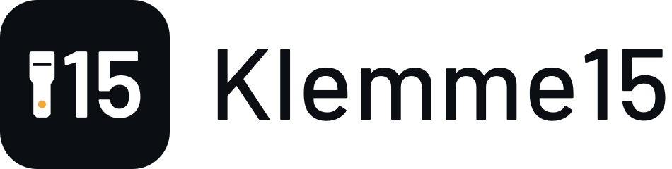
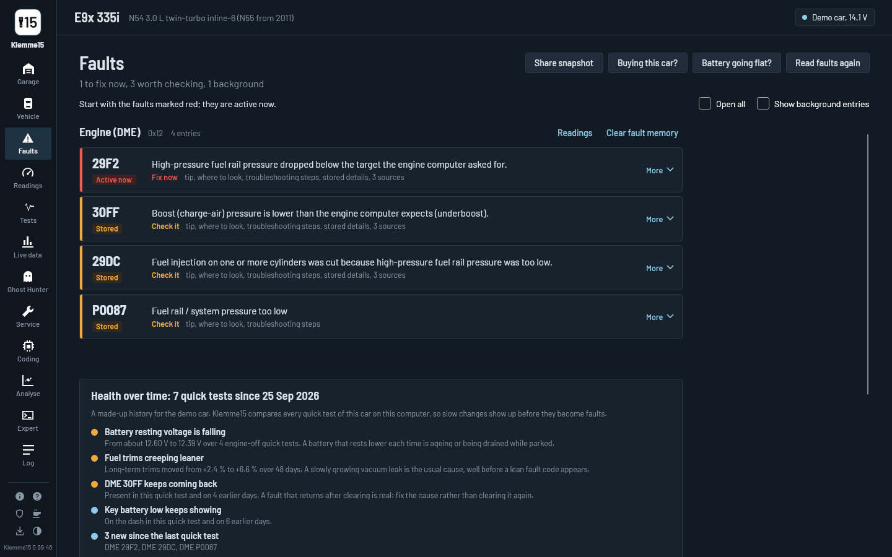

<picture>
  <source media="(prefers-color-scheme: dark)" srcset="docs/brand/klemme15-lockup-dark.svg">
  
</picture>

Klemme15 is free, open-source diagnostics for older BMWs. You plug a K+DCAN cable into the car, run it on your own Windows, Mac or Linux laptop, and it reads the faults and dash warnings from every module and tells you what they mean. It also runs graphed tests, does service jobs like battery registration, and backs up and codes comfort modules. There's no account and no subscription, and nothing you read from the car leaves your computer.

The name comes from terminal 15 (Klemme 15 in BMW's wiring diagrams), the wire that goes live when you turn the key. That's when the car can be asked what's wrong.

**[Download Klemme15](https://expos-ai.github.io/Klemme15/#download)** (the page picks the right file for your computer), or see every version on the [Releases page](https://github.com/Expos-AI/Klemme15/releases).

It's a beta. It has been tested on a 2006 E90 325i over D-CAN: the quick test, reading and clearing faults (Shadow and Info memory included), the dash message history, live data, the fuel trim test and battery registration. In EDIABAS mode (with your own BMW files) the quick test with BMW's fault texts and the brake fluid, spark plug and vehicle check resets have been tested too. The rest is built from published research on each module and checked against simulated cars until someone tries it on a real one. Anything that drives a part or writes to a module, battery registration included, stays behind the experimental switch until it's been confirmed on a car. If you'd like to help with that, the [tester guide](docs/BETA.md) says what to try.



More screenshots, rendered from the demo cars on every change, are on the [screenshots branch](https://github.com/Expos-AI/Klemme15/tree/screenshots).

## Will it work on my car?

| Family | Cable switch | Without BMW files | With your BMW files (EDIABAS mode, Windows) |
|---|---|---|---|
| E90/E91/E92/E93 3 Series (2006-2013) | D-CAN | Every module's faults and dash messages, engine readings, live data, tests, coding backups, battery registration (most engine computers), Valvetronic learning (N52 engines only) | Every module's readings and service functions, BMW fault texts |
| E81/E82/E87/E88 1 Series, E60/E61 5 Series, E63/E64 6 Series (2007 on), E70 X5 / E71 X6, E84 X1, E89 Z4 | D-CAN | Like the E90 family | Like the E90 family |
| E46 3 Series (1999-2006), E39 5 Series, E53 X5, E38 7 Series, E85/E86 Z4 | K-line | Module identification, engine faults and live data (OBD-II), health history, the fuel trim test | Every module's faults, readings and service functions |
| E36 3 Series (1996-1999), E83 X3 (2004-2006), both in beta | K-line | Engine faults, live data and the fuel trim test (OBD-II); the other modules are being mapped with testers | Not tried yet |

Your chassis code is on the sticker in the door jamb. All-wheel-drive models, the E46 coupes and convertibles, the M cars and the diesels sold outside North America are listed under their own names in the app. Tips and tests written for one engine aren't offered on another, so a diesel doesn't get the fuel trim test and only engines with an electric water pump (N51 to N55) get the pump tests.

Only the E90 family has been confirmed on a car so far. The other families are built from BMW's module data and checked against simulated cars, and each [test report](docs/BETA.md) moves one closer to confirmed. The E36 and E83 are still being mapped from owner reports ([E36 tester guide](docs/E36-BETA.md)).

Not supported: cars built before 1996 (E30, E32, E34, E31 and early E36), the 7 Series E65/E66, X3s built from late 2006 on, the Mini, and F- and G-series cars, which use an Ethernet cable. E60 and E87-family cars built before March 2007 have no D-CAN and need EDIABAS mode.

## What you need

A K+DCAN USB cable with a K-line / D-CAN switch and an FTDI chip, the kind sold for INPA and NCS Expert. Every real-car test so far used the [AntiBreak K+DCAN cable with switch](https://www.amazon.com/dp/B079KC43WG). Klemme15 checks the cable before it connects, and the [cable guide](docs/CABLE.md) covers the usual problems.

A 64-bit computer with Windows 10 or 11, macOS (Apple chip or Intel) or Linux. Nothing else needs installing.

BMW's own files are optional. If you have an ISTA, INPA or EDIABAS install on a Windows computer, Klemme15 can use its files for every module's readings, the service functions and BMW's fault texts. Klemme15 never includes them.

## Install

On Windows you can use [Scoop](https://scoop.sh):

```powershell
scoop bucket add klemme15 https://github.com/Expos-AI/Klemme15
scoop install klemme15
```

On any system you can download the zip for your computer from [Releases](https://github.com/Expos-AI/Klemme15/releases) and unzip it. There's no installer. On Windows and Linux, run `Klemme15`; on a Mac, drag `Klemme15.app` to Applications and open it. The command-line tool is in the `cli` folder.

| Your computer | Download |
|---|---|
| Windows 10 or 11 | `Klemme15-v<version>-win-x64.zip` |
| Mac with an Apple chip (M1 or later) | `Klemme15-v<version>-osx-arm64.zip` |
| Mac with an Intel chip | `Klemme15-v<version>-osx-x64.zip` |
| Linux (64-bit) | `Klemme15-v<version>-linux-x64.zip` |

### The first time you open it

Klemme15 isn't signed with a paid Microsoft or Apple certificate yet, so both systems ask once whether you trust it. On Windows, if a blue "Windows protected your PC" box appears, click More info, then Run anyway (installing with Scoop skips this). On a Mac, double-click Klemme15; when macOS says it can't check the app, click Done, open System Settings, then Privacy & Security, scroll down and click Open Anyway next to Klemme15. On macOS 14 or older you can right-click Klemme15 and choose Open instead. On Linux, if it doesn't start, make it executable with `chmod +x Klemme15`.

Every release comes with `SHA256SUMS.txt` and a signed record of the code it was built from, so you can [check your download](SECURITY.md#verifying-your-download) before you run it.

### Updating

The arrow button at the bottom of the sidebar checks for a newer version and downloads the file for your computer. Unzip it and use it in place of the old folder; your settings, cars and history live in your user folder and are kept. With Scoop, run `scoop update klemme15`.

## Quick start

1. Plug the cable into the OBD port under the dashboard and set its switch: K-line for the E46, E39, E53, E38, Z4 E85/E86, X3 E83 (to 2006) and E36, D-CAN for the E90 family and newer.
2. Switch the ignition on (key position 2, engine off).
3. In Klemme15, pick your car in the Garage (type the model and year, like "2011 328i", if you don't know the chassis code) and press Connect to my car. Choose the cable's port and press Check cable, and fix anything it flags.
4. Press Connect, then Run quick test on the Vehicle page.

No car nearby? Pick any model and press Open demo car.

## What it does

### Finding out what's wrong

The quick test finds every fitted module with one broadcast and reads its part number and fault memory. Klemme15 knows 45 E90-family modules and 23 E46 modules. Faults are sorted into fix now, worth checking and background, so ten codes don't turn into ten parts, and faults that share one cause (a low-voltage event, several modules that lost contact with the same one, faults stored at the same mileage) are grouped together.

Each fault gets a meaning in plain words. 203 BMW codes for the E90 family are researched with sources (and shown on other families wherever the module version is the same), all 2,066 standard OBD-II codes are included, and any other code gets a meaning from its number range. BMW's own text for your exact module comes from the free [bmw-unified-db](https://github.com/gediz/bmw-unified-db) download or your own files ([how](docs/FAULT-DATA.md)).

The dash messages explain why the warning triangle is lit when no module has a code: 396 messages are covered, with how serious each one is and what to do ([details](docs/CHECK-CONTROL.md)). The cluster also remembers its last few dozen warnings with the mileage, and Klemme15 tells them as a timeline. Five systems complaining at the same moment is usually one voltage dip, not five faults.

### Testing before you buy parts

Guided tests tell you what to do (idle, hold 2,500 rpm, blip the throttle), graph what the engine does and end with a verdict. There are tests for fuel trims, VANOS, cylinder roughness, a rough idle with the air conditioning on, a car that won't start, the electric water pump and bleeding the cooling system. If you don't have a code to start from, pick what the car does and Klemme15 shows what the car already reports about it and what to check, in order.

Diagnostic chains walk through a mechanic's reasoning step by step. The vacuum leak hunter, the charging system check and the warm-up (thermostat) check are offered under matching faults, and anyone can write a new one ([how](docs/CHAINS.md)). Under many faults there are multimeter and swap checks for the connector, ground, coil or solenoid involved.

Live data can be recorded to CSV and replayed on the Analyse page, with the healthy range for your engine drawn behind it ([baselines](docs/BASELINES.md)).

### Catching what only happens sometimes

The Ghost Hunter watches for what you're chasing (a misfire, a voltage dip, a lean idle, a chug at idle, overheating, a stall) while you drive and saves the minute before and after each time it happens. The battery drain finder shows what the car recorded about its battery running down, works out how many days your parked current leaves you, and walks you through the fuse-pull hunt. Each quick test also leaves a small record on your computer, so a battery that rests lower each week or fuel trims creeping lean show up before they become faults.

### Doing the job yourself

There are 78 functions, all experimental: service reminder resets, battery registration, the steering lock counter reset for early E90s with a key slot, adaptation resets, Valvetronic and DISA learning, cylinder cut-out, DSC and gearbox functions and more. Battery registration (on most engine computers) and Valvetronic learning (N52 engines only) work over the cable alone; the rest run BMW's own procedures from your files in EDIABAS mode. Each one checks the car first and asks you to confirm every requirement, and if a module refuses, Klemme15 says why and lists the faults it has stored ([the list](docs/SERVICE-FUNCTIONS.md), [how they're kept safe](docs/SERVICE.md)).

### Coding comfort options

On D-CAN cars Klemme15 backs up, compares and restores a comfort module's coding without BMW files. Quick codes (LED bulb warnings off, digital speed, mirror folding and others) only unlock when Klemme15 knows exactly where the option lives on your module, from your NCS Expert reading, from watching another coding tool, or from a map shared by an owner of the identical module ([walkthrough](docs/QUICK-CODES.md)). Every write is backed up, read back and undone if anything is off. Nothing is written below 10.5 V, coding needs 12.5 V, and the FRM3 footwell module, which can corrupt itself on a voltage dip, is only written to at 13.0 V or more.

### Sharing and automating

A snapshot (.k15) puts your whole car in one file that someone helping you can open read-only, with the VIN removed ([how](docs/SNAPSHOTS.md)). Each one has a short fingerprint that shows it wasn't changed, and two snapshots can be compared before and after a repair. A session recording (.k15log) keeps everything Klemme15 asked and the car answered, so it can be played back later without the car; it contains the VIN, so send it privately ([how](docs/RECORDINGS.md), pending field validation). Community reading maps are small files, worked out on real cars, that let Klemme15 show a module's values without BMW files ([how](docs/READING-MAPS.md), pending field validation).

If you're buying a used BMW, the pre-purchase check compares the mileage every module remembers with each other and with the odometer, so a wound-back or swapped cluster stands out, and it flags safety faults and freshly cleared memories. Reports save as HTML, Markdown or JSON, and there's a short summary for forum posts. There's also a [command line](docs/COMMAND-LINE.md) and a [headless mode](docs/HEADLESS.md) with a phone dashboard and MQTT.

## Safety

Reading is the default and clearing faults asks first. Service functions and tests that switch a part on check the car, ask you to confirm each requirement, and hand the part back to the module when they finish, fail or you press Stop. Coding is limited to comfort modules and backed up first. Klemme15 never flashes software, never touches keys or the immobiliser, never codes the key module (CAS) and never changes mileage. Its one job in the key module is clearing the steering lock's event counters ([why](docs/ROADMAP.md#not-planned-on-purpose)).

If a job is cut off because the cable comes out, the laptop sleeps or Windows restarts, Klemme15 remembers it and says what to do next. While a job runs it keeps the computer awake. Don't use it while driving: set up the Ghost Hunter or a recording before you set off, or have a passenger watch.

## Privacy

What Klemme15 reads from your car stays on your computer. There's no account, no telemetry and no server, and it only goes online when you ask it to. The [privacy policy](PRIVACY.md) lists every file it saves.

[Safety, legal and transparency](docs/LEGAL.md) covers working on the car safely, what experimental means, copyright and BMW's software, trademarks, how good the fault meanings are, and how Klemme15 is made (AI coding tools help write parts of it). Klemme15 comes with no warranty; you use it at your own risk.

## Getting help

For cable or connection problems, start with the [cable guide](docs/CABLE.md). For a bug or a question, [open an issue](https://github.com/Expos-AI/Klemme15/issues/new/choose); a snapshot of your car (Faults page, Share snapshot) usually shows what happened. Security problems should be reported privately, as described in [SECURITY.md](SECURITY.md).

## Contributing

Testing on your car helps most, and the [tester guide](docs/BETA.md) says what to try. You can also share a coding map, a check for a part you've tested, a healthy baseline from your car's log, or a fault meaning with sources ([how](CONTRIBUTING.md)). Building from source is covered in [CONTRIBUTING.md](CONTRIBUTING.md) and the code's layout in [docs/ARCHITECTURE.md](docs/ARCHITECTURE.md).

Klemme15 is free and will stay free, with nothing locked and no ads. If it saved you a trip to the shop, you can leave a tip with [PayPal](https://paypal.me/KindricC) or through [GitHub Sponsors](https://github.com/sponsors/Expos-AI). A tip is a thank-you and doesn't buy support or features. A test report from your car helps just as much.

## Legal

Klemme15 contains no BMW software, SGBD files, fault texts, documents or wiring diagrams, and contributions must not add any. Its fault meanings are written from public sources, and its own connection to the car is written from public standards (ISO 14230, ISO 9141-2, SAE J1979) and community knowledge. EDIABAS mode runs files you already have from your own installation; they're never bundled or uploaded, and Klemme15 never unlocks BMW's protected ISTA databases ([fault data](docs/FAULT-DATA.md)).

Klemme15 is an independent project, not affiliated with or endorsed by BMW AG. BMW, ISTA, INPA, NCS Expert, EDIABAS, TIS and WDS are trademarks of BMW AG.

## Credits

[EdiabasLib](https://github.com/uholeschak/ediabaslib) by Ulrich Holeschak (GPLv3) powers EDIABAS mode. [bmw-unified-db](https://github.com/gediz/bmw-unified-db) provides the optional BMW fault texts, downloaded by you and not bundled. The interface is built with [Avalonia UI](https://avaloniaui.net). The standard OBD-II code titles come from [python-OBD](https://github.com/brendan-w/python-OBD) (GPL-2.0-or-later), and the app uses the [Barlow](https://github.com/jpt/barlow) typeface by Jeremy Tribby (SIL Open Font License 1.1).

## License

Copyright (C) 2026 Kindric Castro. Created and led by Kindric Castro.

GPL-3.0-or-later; see [LICENSE](LICENSE) and [COPYRIGHT](COPYRIGHT). Contributions are accepted under the same license with a [Developer Certificate of Origin](CONTRIBUTING.md#sign-off-your-commits-dco) sign-off.
